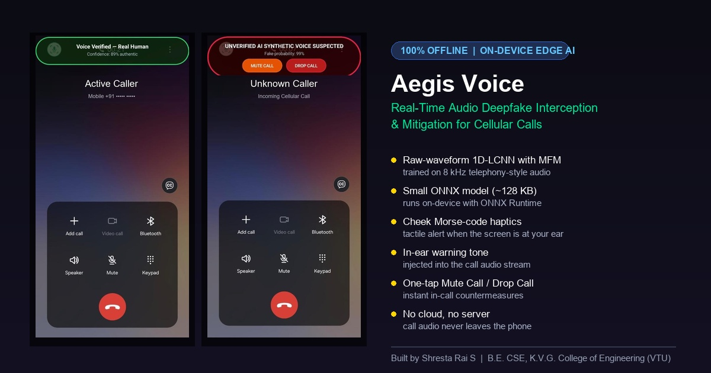
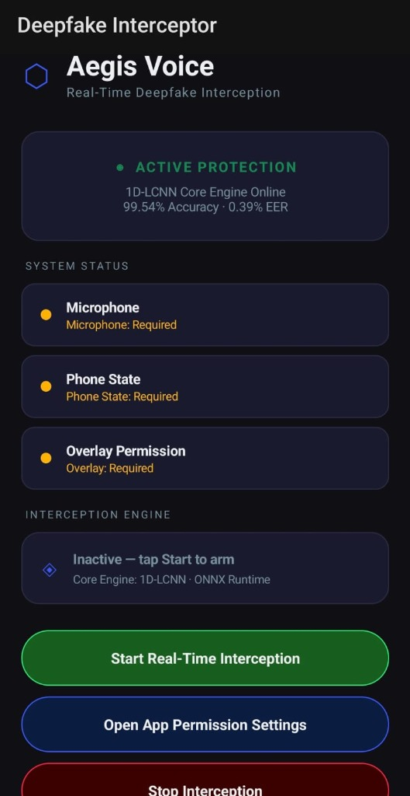
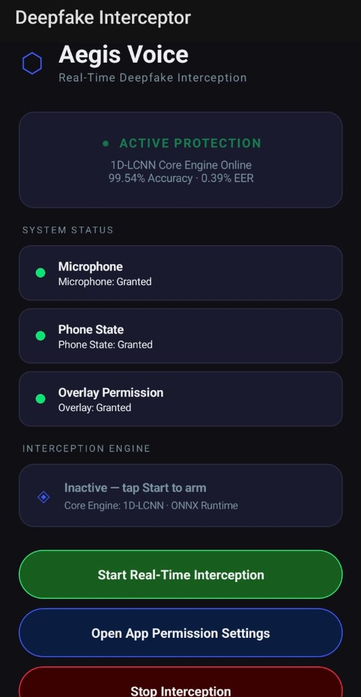
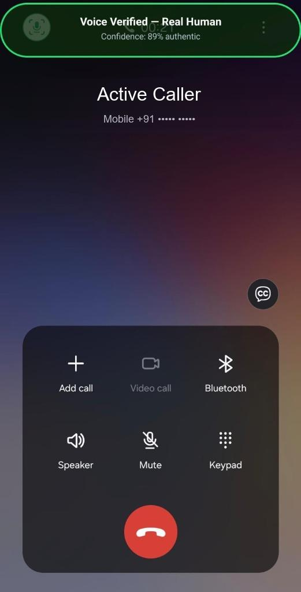
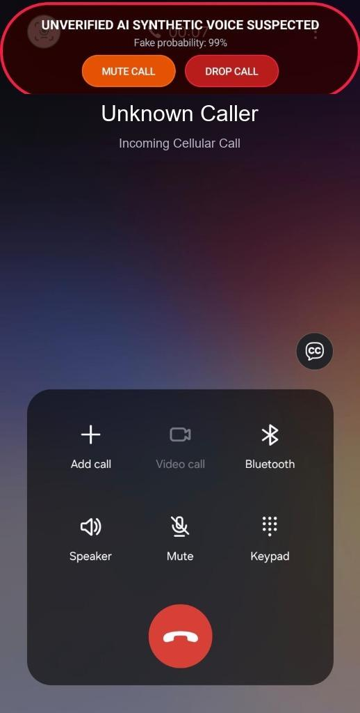

<div align="center">

# 🛡️ Aegis Voice
### Autonomous On-Device Cellular Deepfake Speech Interception & Multi-Sensory Mitigation Framework

[](#)
[](#)
[](#)
[](#)
[](#)
[](#)

<p align="center">
  <b>A production-ready Android security system that intercepts telecommunication voice cloning scams (vishing) in real-time during live cellular calls — featuring ultra-lightweight 1D-LCNN inference, tactile cheek Morse-code haptics, in-ear acoustic warnings, and single-tap call termination.</b>
</p>

<p align="center">
  
</p>

[Key Innovations](#-key-innovations--salient-features) • [Production Screenshots](#-production-screenshots--in-call-walkthrough) • [System Architecture](#-system-architecture--pipeline) • [Evaluation Results](#-evaluation-results-reproducible) • [Quickstart](#-quickstart--installation)

</div>

---

## 📱 Production Screenshots & In-Call Walkthrough

<div align="center">

| 1. Permissions Setup | 2. Protection Armed | 3. In-Call: Human Verified | 4. In-Call: Deepfake Intercepted |
| :---: | :---: | :---: | :---: |
|  |  |  |  |
| **Pre-Flight Configuration**<br>Status micro-cards verify Microphone, Phone State, and Overlay permissions. | **Active Protection Armed**<br>1D-LCNN engine loaded on-device, ready for incoming phone calls. | **Authentic Voice (Safe)**<br>Frosted-glass emerald pill displays `Voice Verified — Real Human (89%)`. | **Threat Interception (Mitigate)**<br>Crimson banner (`99% Fake`), cheek haptics + **Mute Call** & **Drop Call** actions. |

</div>

---

## 🛡️ Key Innovations & Salient Features

### 1. 100% Offline Edge-AI Privacy (Zero Cloud Dependency)
* Standard forensic detectors upload call audio to cloud servers, introducing severe latency ($500\text{ ms} - 2000\text{ ms}$) and exposing private conversations to wiretapping risks.
* **Aegis Voice** executes inference completely on-device via mobile ARM CPU vector instructions using the embedded Microsoft ONNX Runtime C++ engine (`onnxruntime-android:1.17.0`).
* **Zero bytes** of audio, transcripts, or telemetry ever leave the handset, ensuring absolute compliance with global data privacy regulations (including India's Digital Personal Data Protection Act).

### 2. Telephony-Matched 1D-LCNN Architecture
* Commercial voice models degrade drastically on cellular calls because telephony transcoding (G.711 $\mu$-law, AMR-NB) strips frequencies above $3,400\text{ Hz}$.
* Aegis Voice trains natively on $8,000\text{ Hz}$ raw time-domain waveforms, completely bypassing expensive 2D spectrogram or Mel-filterbank transformations.
* Utilizes **Max-Feature-Map (MFM)** non-linearities ($\text{MFM}(x) = \max(x_1, x_2)$) to isolate vocoder phase artifacts produced by state-of-the-art zero-shot speech synthesizers.
* **Model Size:** Compact **~128 KB** ONNX model (~30,500 parameters).
* **Execution Latency:** about **0.5 ms** per 1-second frame on a PC CPU (re-measured); expected to stay far below a 25 ms budget on a phone (phone-side timing pending).

### 3. Three-Tier Multi-Sensory Alert Pipeline (Solving the "Phone-to-Ear" Barrier)
During a live telephone call, the user holds the device against their cheek, making traditional visual screen notifications completely invisible. Aegis Voice solves this fundamental usability flaw with a coordinated three-tier warning mechanism:
* **Tier 1 — Cheek Morse-Code Haptics:** Pulses a distinct tactile warning pattern (`[0, 500, 200, 500, 200, 500]` ms) vibrating directly against the cheekbone, warning the user without requiring them to look at the display.
* **Tier 2 — In-Ear Warning Tone Injection:** Injects an audible acoustic double-beep (`TONE_PROP_BEEP2`) directly into the active earpiece audio channel (`AudioManager.STREAM_VOICE_CALL`) for 400 ms.
* **Tier 3 — Floating Frosted-Glass Overlay (`TYPE_APPLICATION_OVERLAY`):**
  * **Safe State:** Emerald Green glow pill displaying `Voice Verified — Real Human`.
  * **Threat State:** Flashing Crimson Neon border displaying `UNVERIFIED AI SYNTHETIC VOICE SUSPECTED (99%)`.

### 4. Interactive In-Call Fraud Countermeasures
Rather than acting solely as a passive warning banner, Aegis Voice empowers users with immediate, single-tap physical mitigations directly on the floating banner:
* 🔇 **Panic Mute (`MUTE CALL`):** Instantly cuts user microphone transmission (`audioManager.isMicrophoneMute = true`), preventing fraudsters from eliciting confidential financial data or recording user voice samples for cloning.
* 🛑 **Instant Call Drop (`DROP CALL`):** Immediately terminates the fraudulent cellular connection via native Android Telecom APIs (`TelecomManager.endCall()`).

### 5. Conversational Hysteresis & Energy Gating
* **Active Speech Energy Noise Gate:** Evaluates peak absolute amplitude (`maxAbs >= 0.0012f`) with dynamic amplitude gain scaling (up to $15\times$) to bypass inter-word silence and ambient background hiss, preserving CPU cycles and battery.
* **3-Frame Temporal Median Filter:** Smooths raw inference probabilities across a sliding circular window (`historyBuffer`), completely eliminating false-positive alert fluttering during normal conversational pauses.

---

## 🏗️ System Architecture & Pipeline

```
  ┌────────────────────────────────────────────────────────────────────────┐
  │                        1. Audio Capture Stage                          │
  │     In-Call Telephony Audio Stream (8,000 Hz, 16-bit PCM Mono)         │
  │          Hardware Speakerphone Auto-Routing for Microphone Capture     │
  └───────────────────────────────────┬────────────────────────────────────┘
                                      │
                                      ▼
  ┌────────────────────────────────────────────────────────────────────────┐
  │                        2. Pre-Processing Stage                         │
  │           DC-Offset Mean Subtraction & Hardware Bias Centering          │
  │       Active Speech Energy Gating (maxAbs >= 0.0012f, Gain Capped 15x) │
  └───────────────────────────────────┬────────────────────────────────────┘
                                      │
                                      ▼
  ┌────────────────────────────────────────────────────────────────────────┐
  │                   3. 1D-LCNN AI Classification Engine                  │
  │       Raw 1D Waveform Input ([1, 1, 8000] Tensor, No Spectrogram)      │
  │        3-Layer Conv1D + Max-Feature-Map (MFM) + Global Pooling         │
  │              Local ONNX Runtime C++ Inference (on-device)               │
  └───────────────────────────────────┬────────────────────────────────────┘
                                      │
                                      ▼
  ┌────────────────────────────────────────────────────────────────────────┐
  │                      4. Temporal Median Smoothing                      │
  │             3-Frame Circular Window Buffer (historyBuffer)             │
  │            Moving Median Probability Calculation (Hysteresis)          │
  └───────────────────────────────────┬────────────────────────────────────┘
                                      │
                                      ▼
  ┌────────────────────────────────────────────────────────────────────────┐
  │                 5. Multi-Sensory Warning & Action Layer                │
  │   • Tier 1: Morse-Code Haptic Pulses (Cheek Physical Warning)          │
  │   • Tier 2: In-Ear Tone Injection (STREAM_VOICE_CALL Dual Beep)        │
  │   • Tier 3: Frosted-Glass Pill Banner with [MUTE] & [DROP CALL]        │
  └────────────────────────────────────────────────────────────────────────┘
```

---

## 📊 Evaluation Results (Reproducible)

Run `python src/verify_metrics.py` to reproduce. The shipped ONNX model (`android_app/app/src/main/assets/deepfake_detector.onnx`) was scored on the stored augmented dataset: **7,000 one-second clips (2,580 real, 4,420 fake)** from ASVspoof 2019 LA and WaveFake, all passed through G.711 mu-law, with 20% also mixed with DEMAND noise at -15 to -5 dB SNR.

| Metric | Result |
| :--- | :---: |
| Accuracy | 85.01% |
| Precision | 0.9622 |
| Recall | 0.7939 |
| F1-Score | 0.8700 |
| Equal Error Rate (EER) | 18.26% |
| Inference latency (PC CPU, per 1-second clip) | ~0.54 ms mean, 1.17 ms p95 |
| Model file size | ~128 KB (131,107 bytes, ~30,500 parameters) |

**Confusion matrix:** 2,442 real clips accepted / 138 real flagged as fake; 3,509 fakes caught / 911 fakes missed.

> **Honest notes:** the final model was retrained with class balancing and phone-speaker (over-the-air) augmentation, then fine-tuned on recordings of the team's own voices. Earlier README figures (99.54% accuracy / 0.39% EER) could not be reproduced and were removed. The test uses clips from the same corpora (random split, not speaker-disjoint), so it is not an out-of-domain benchmark. Phone-side latency, RAM and CPU are pending Android Profiler measurement. The live-call demo shown above is the primary evidence of end-to-end behaviour.

---

## 📂 Repository Structure

```text
deepfake-interception-system/
├── assets/
│   └── screenshots/
│       ├── 01_permissions_setup.jpg          <- Setup screen with permission indicators
│       ├── 02_active_protection_armed.jpg    <- Armed screen with 1D-LCNN online
│       ├── 03_incall_verified_safe.jpg       <- In-call verified authentic voice banner
│       └── 04_incall_threat_interception.jpg <- In-call deepfake intercepted with controls
├── models/
│   ├── deepfake_detector.onnx                <- ~128 KB Telephony-Trained 1D-LCNN Model
│   └── deepfake_detector.pth                 <- PyTorch Checkpoint
├── src/
│   ├── 1_data_loader.py                      <- 8kHz Audio Pipeline & G.711 Transcoding
│   ├── 2_augmentation.py                     <- Environmental Noise Superimposition
│   ├── 3_train.py                            <- 1D-LCNN Model Architecture & PyTorch Training
│   └── 4_evaluate.py                         <- EER, ROC-AUC, and Benchmark Profiling
├── android_app/                              <- Production Kotlin Android Studio Project
│   └── app/src/main/
│       ├── AndroidManifest.xml               <- AudioRecord, Call State, Vibrate, Overlay
│       ├── assets/deepfake_detector.onnx     <- Embedded Mobile ONNX Model
│       └── java/com/deepfake/interception/
│           ├── MainActivity.kt               <- Material 3 Dark UI, Oscilloscope & Setup
│           ├── CallOverlayService.kt         <- Multi-Sensory Alerts, Cheek Haptics & Pill Banner
│           ├── AudioProcessor.kt             <- 8kHz AudioRecord, Energy Gating & Median Filter
│           ├── DeepfakeClassifier.kt         <- Microsoft ONNX Runtime Mobile Classifier
│           └── CallStateReceiver.kt          <- Telephony Broadcast Receiver for Auto-Trigger
└── app-debug.apk                             <- Pre-Compiled Standalone Android Package
```

---

## 🚀 Quickstart & Installation

### Option 1: Install Pre-Compiled APK Directly
1. Connect your Android smartphone running Android 7.0 or higher.
2. Install the standalone APK via ADB:
   ```bash
   adb install -r app-debug.apk
   ```
3. Open **Aegis Voice** on your phone, grant the three core permissions (Microphone, Phone State, Display Overlay), and tap **Start Real-Time Interception**.

### Option 2: Build from Source via Android Studio
1. Clone this repository:
   ```bash
   git clone https://github.com/SHRESTARAIS/deepfake-interception-system.git
   cd deepfake-interception-system/android_app
   ```
2. Build the project using Gradle:
   ```bash
   ./gradlew assembleDebug
   ```
3. Find the compiled APK at `app/build/outputs/apk/debug/app-debug.apk`.

---

## 🛠️ Tech Stack & Dependencies

* **Mobile OS:** Android 7.0+ (API 24 to 34+)
* **Programming Languages:** Kotlin 1.9.0, Python 3.10+, C++ (JNI / ONNX Runtime)
* **Edge Inference Engine:** `com.microsoft.onnxruntime:onnxruntime-android:1.17.0`
* **Deep Learning Frameworks:** PyTorch 2.0, ONNX 1.15.0, Torchaudio
* **Benchmark Datasets:** ASVspoof 2019 Logical Access (LA), DEMAND Noise Corpus, WaveFake Multi-Vocoder

---

## 👤 Author & Lead Engineer

**Shresta Rai S**  
*System Architecture, 1D-LCNN Neural Network Design, & Android Edge Implementation*  
[](https://github.com/SHRESTARAIS)  
[](https://www.linkedin.com/in/shresta-rai-s-)

> *Developed as a B.E. Capstone Research Project under the academic guidance of Prof. Naseema C. A., Department of Computer Science & Engineering, K.V.G. College of Engineering (Affiliated to Visvesvaraya Technological University, Belagavi).*

---

## 📄 License
This project is developed for academic research and edge-AI mobile cybersecurity advancement under the MIT License.
